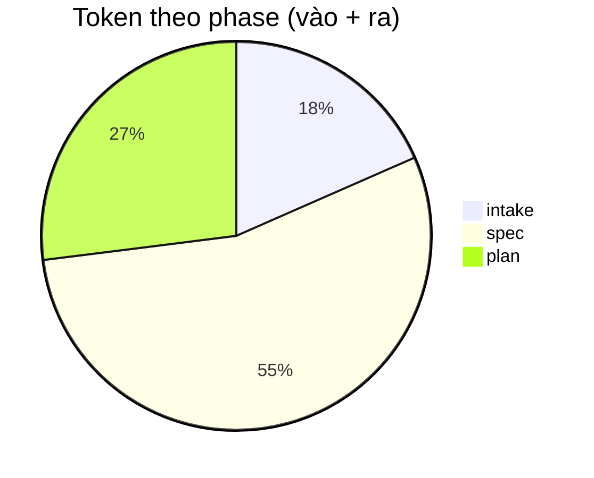

# Spec: SP20 — File tiến độ của việc (phase, thời gian tương tác, token)

- Ngày: 2026-10-23 · Branch: `claude/modest-hypatia-h7npnz`
- Roadmap § SP20. Interface: không đổi — đây là đo đạc của harness (cùng lớp với `aw journal`), không
  phải năng lực của một stage SDLC; không thêm luật chặn/cảnh báo nào.

## Vấn đề

Người làm một việc không có chỗ nào nhìn một lần mà biết: việc đang ở phase nào, mỗi phase tốn bao
nhiêu thời gian người–agent thật sự làm việc, tốn bao nhiêu token. Hiện có:

- `aw ready <dir>` § Tiến độ — artifact nào có, bước tiếp. Chỉ in ra terminal, không có số liệu.
- `journal/checks.tsv` — giờ và mã thoát mỗi lần `aw check`. Có mốc **kết thúc** phase (ĐẠT đầu tiên),
  không có mốc **bắt đầu**, không có thời gian tương tác, không có token.

SP9 cần đúng số liệu này ("thời gian phase") mà công cụ chưa ghi.

## Đã chốt với người (trước spec)

1. File là **Markdown + Mermaid** (`progress.md`): bảng + Gantt + biểu đồ tròn token. HTML không làm:
   không hiển thị trong giao diện git, diff ồn, khó sinh bằng sh/awk.
2. File nằm **trong thư mục việc** (`docs/sdlc/<branch>/progress.md`) và được commit cùng artifact.
3. **Token chỉ đo trên Claude Code** (đọc transcript qua hook). Cursor: chỉ thời gian theo đồng hồ;
   cột token ghi `—`.

## Phạm vi

Làm:

- Ghi mốc bắt đầu phase; ghi lượt (thời gian + token) từ hook Claude Code.
- `aw status <dir>` in tóm tắt, `--write` sinh `progress.md`; `aw check <phase>` ĐẠT tự sinh lại file
  trước khi commit artifact.
- `aw journal export` / `report` mang thêm hai nguồn mới (để SP9 gộp nhiều máy).

Không làm:

- Chi phí bằng tiền (giá đổi theo model và thời điểm; người tự nhân).
- Chi tiết từng lượt trong `progress.md` (vài chục lượt làm biểu đồ rối) — chi tiết ở `turns.tsv`.
- Đưa bảng vào mô tả MR — xem § Cần người quyết.
- Luật chặn/cảnh báo dựa trên số liệu (vd phase quá lâu). Chờ số liệu SP9.

## Thiết kế

### 1. Dữ liệu — hai nguồn mới ở `$AW_CONFIG/journal/` (không commit, `AW_JOURNAL=0` tắt)

`phases.tsv` — một dòng mỗi lần một phase bắt đầu:

| cột | ví dụ |
|---|---|
| `ts` (UTC ISO, như `checks.tsv`) | `2026-10-23T07:10:00Z` |
| `worktree` (git top) | `/home/u/repo-wt/feat-otp` |
| `feature` (`viec`, như `checks.tsv`) | `feat_login-otp` |
| `phase` | `spec` |

`turns.tsv` — một dòng mỗi lượt (người gửi prompt → agent dừng), hoặc mỗi subagent kết thúc:

| cột | ghi chú |
|---|---|
| `ts_begin`, `ts_end` | UTC ISO; subagent: `ts_begin` = `-` |
| `worktree`, `feature`, `phase` | gắn theo § 3; không gắn được → `-` |
| `session` | `session_id` của payload hook |
| `kind` | `main` \| `subagent` |
| `seconds` | `ts_end − ts_begin`; subagent `0` (thời gian đã nằm trong lượt main) |
| `in`, `out`, `cache_read`, `cache_write` | tổng `usage` của các message assistant trong lượt; không đọc được → rỗng |

Chỉ ghi **số**, không chép nội dung transcript.

### 2. Mốc bắt đầu phase

- Bước 0 của mọi lệnh phase do `ad_sinh` sinh (`buoc_xac_dinh_feature`, `adapters/lib/common.sh`) gọi
  `aw feature … --phase <id>` thay cho `aw feature …`. Một lệnh, không thêm bước agent có thể quên;
  chữ chung cho mọi adapter nên test `AW_COMPARE=1` vẫn giữ.
- `tools/feature.sh`: `--phase <id>` (id phải có trong `phases:` của `workflow.yaml`, sai → `TÊN KHÔNG
  HỢP LỆ`). Khi kết quả là `ĐÃ XÁC ĐỊNH` thì ghi một dòng `phases.tsv`; mã khác không ghi. Lỗi ghi im
  lặng (như `journal.sh _check`). Không có `--phase` → hành vi như cũ (`aw feature` còn được gọi ngoài
  lệnh phase).
- Mỗi lần chạy lệnh phase là một dòng. Một phase chạy nhiều phiên (mở lại sau khi nghỉ, làm lại sau
  review) → nhiều dòng; § 4 gộp.

### 3. Lượt và token — hook Claude Code

Ba hook, người tự thêm vào `.claude/settings.json` cạnh `aw guard` (adapter không ghi settings của repo
đích — `adapters/claude-code/README.md` § Hook):

| sự kiện | lệnh |
|---|---|
| `UserPromptSubmit` | `aw journal _turn begin` |
| `Stop` | `aw journal _turn end` |
| `SubagentStop` | `aw journal _turn sub` |

`journal.sh _turn`:

- Đọc payload JSON từ stdin bằng `sed` (không jq): `session_id`, `transcript_path`, `cwd`,
  `agent_transcript_path` (subagent). Thiếu trường cần → thoát 0, không ghi.
- **Không in gì ra stdout, luôn thoát 0**: stdout của `UserPromptSubmit` bị chèn vào ngữ cảnh agent;
  mã khác 0 làm hỏng lượt. Mọi lỗi im lặng.
- `begin`: ghi `ts` vào `journal/.turn/<session>`.
- `end`: đọc transcript **từ vị trí đã đọc lần trước** (byte offset lưu cùng file `.turn/<session>`,
  `tail -c +N`) tới cuối; awk cộng `input_tokens`, `output_tokens`, `cache_read_input_tokens`,
  `cache_creation_input_tokens` của dòng `"type":"assistant"`, **khử trùng theo `message.id`** (một
  message có thể xuất hiện nhiều dòng với cùng `usage`). Ghi dòng `turns.tsv`, cập nhật offset.
  Thiếu `begin` (hook cài giữa lượt) → `seconds` rỗng, token vẫn ghi.
- `sub`: như `end` trên `agent_transcript_path`, đọc cả file, `kind=subagent`. Token của subagent
  (vd review) nằm ở transcript riêng, không có trong transcript chính.
- Gắn phase: `worktree` = git top của `cwd`; phase = dòng `phases.tsv` mới nhất của worktree đó có
  `ts` ≤ `ts_end`. Không có → `-`.
- Thời gian chạy hook phải nhỏ: chỉ đọc phần transcript mới, không quét lại cả file.
- Định dạng transcript không phải API công khai: trường thiếu → token rỗng, không vỡ. Test dùng
  transcript mẫu (fixture); đổi định dạng thì sửa awk + fixture.
- Cursor chạy cả hook của `.claude/settings.json` nhưng payload khác: không có `transcript_path` →
  không ghi (không ghi dòng rác).

### 4. Tính số liệu một phase

Với mỗi phase của việc, theo thứ tự `phases:` trong `workflow.yaml`:

- **Lần chạy** = các khoảng từ một dòng `phases.tsv` tới dòng `phases.tsv` kế tiếp của cùng worktree
  (bất kể phase nào), hoặc tới bây giờ.
- **Đồng hồ** = tổng độ dài các lần chạy của phase đó; lần chạy cuối của việc đang mở thì tính tới
  sự kiện cuối cùng (không tới "bây giờ", để sinh lại file không đổi số khi không có gì mới — § 5).
- **Tương tác** = tổng `seconds` các lượt `main` gắn phase đó.
- **Lượt** = số lượt `main`; **token** = tổng 4 cột, cả `main` lẫn `subagent`.
- **Check chặn** = số dòng `checks.tsv` của checker phase đó, mã khác 0, trong các lần chạy của nó.
- **Trạng thái**:
  - `✓ ĐẠT` — có dòng `checks.tsv` mã 0 sau lần bắt đầu cuối;
  - `▶ đang làm` — phase của dòng `phases.tsv` mới nhất và chưa ĐẠT sau đó;
  - `— bỏ qua` — design khi `kc_bo_design` (`tools/lib/cross-check.sh`) đúng;
  - `·` — còn lại.
  Việc bắt đầu trước SP20 (có check, không có mốc bắt đầu): phase có ĐẠT vẫn hiện `✓`, ô thời gian `—`.

### 5. `progress.md`

`tools/status.sh` (đăng ký trong `tools/lib/commands.sh`, `bin/aw-engine`):

```
aw status <thư-mục-feature>            in bảng ra terminal
aw status <thư-mục-feature> --write    ghi <thư-mục-feature>/progress.md
```

Nhãn (`kq_khai`): `0=XONG` (đã in bảng; `--write`: đã ghi `progress.md`), `2=SAI THAM SỐ`. Không có dữ liệu journal nào →
vẫn in/ghi (mọi ô `—`), không lỗi (XONG).

`aw check <phase>` ĐẠT: gọi `status.sh --write` **trước** `ar_commit` (`bin/aw-engine`), để
`progress.md` đi cùng commit artifact `chore(sdlc): …`. Lỗi sinh file → cảnh báo, không đổi kết quả
check. Không ghi sau mỗi lượt (tránh commit nhiễu; giữa hai check, xem bằng `aw status`).

Nội dung (heading, nhãn cột tiếng Việt vì người đọc; dữ liệu máy đọc trong khối chú thích):

````markdown
# Tiến độ — feat_login-otp

Phase hiện tại: **plan** · cập nhật 2026-10-23 07:52 UTC · máy: laptop-a, ci-b

| Phase | Trạng thái | Tương tác | Đồng hồ | Lượt | Check chặn | Token vào | Token ra | Cache đọc | Cache ghi |
|---|---|---|---|---|---|---|---|---|---|
| intake | ✓ ĐẠT | 6m | 25m | 4 | 0 | 82k | 6k | 310k | 40k |
| spec | ✓ ĐẠT | 18m | 2h10m | 11 | 2 | 240k | 21k | 1.2M | 90k |
| design | — bỏ qua | | | | | | | | |
| plan | ▶ đang làm | 9m | 40m | 5 | 0 | 120k | 9k | 600k | 30k |
| implement | · | | | | | | | | |
| review | · | | | | | | | | |
| ship | · | | | | | | | | |
| **Tổng** | | 33m | 3h15m | 20 | 2 | 442k | 36k | 2.1M | 160k |

```mermaid
gantt
  title Dòng thời gian
  dateFormat X
  axisFormat %d/%m %H:%M
  section intake
  intake :done, 1761203400, 1761204900
  section spec
  spec :done, 1761206000, 1761213800
  chặn :milestone, crit, 1761210000, 1761210000
  section plan
  plan :active, 1761214000, 1761216400
```





<!-- aw-progress v1
machine	phase	runs	wall_s	active_s	turns	blocked	in	out	cache_read	cache_write	first_ts	last_ts
… một dòng mỗi (máy, phase) …
-->
````

- **Gantt**: mỗi lần chạy một thanh (`done` nếu đã ĐẠT, `active` nếu đang làm); mỗi check chặn một
  milestone `crit`. Thấy được khoảng chờ người giữa các phase và phase nào bị chặn nhiều.
- **Pie**: chỉ phase có token > 0, đơn vị nghìn token (vào + ra; cache tách riêng ở bảng vì đơn giá
  khác). Không phase nào có token (Cursor) → bỏ khối pie, ghi một dòng "Token: không đo trên agent này".
- **Tất định**: cùng dữ liệu → cùng byte. "cập nhật" là giờ sự kiện cuối, không phải giờ chạy lệnh.
  Số làm tròn: thời gian `Xh Ym` / `Ym` / `Zs`; token `k` (nghìn, làm tròn), `M` (triệu, 1 số lẻ).
- Phase id và nhãn trong Mermaid chỉ là id phase (ASCII) và chữ cố định của engine — không chèn chữ
  người viết, không cần thoát ký tự.

**Cộng dồn nhiều máy.** `turns.tsv` chỉ ở máy đang chạy; việc làm tiếp ở máy khác (cùng branch) thì
máy đó không có số liệu cũ. Khối `aw-progress v1` giữ tổng theo (máy, phase): khi sinh lại, dòng của
**máy này** tính lại từ journal, dòng của máy khác giữ nguyên từ file cũ, rồi cộng. Tên máy như
`aw journal export` (`hostname` hoặc `AW_JOURNAL_MACHINE`). Khối sai dạng → bỏ, in cảnh báo, sinh từ
journal máy này.

**Sau ship.** `aw ship create` gỡ thư mục việc khỏi branch trước khi push (`docs/kien-truc.md` § Artifact
theo việc), nên `progress.md` không vào diff MR; file vẫn ở máy và trong lịch sử branch (mất nếu
squash-merge). Xem § Cần người quyết.

### 6. `aw journal export` / `report`

- `export`: thêm nguồn `phases`, `turns` (cùng cột `source`, `machine` như SP9).
- `report`: thêm mục "Thời gian và token theo phase" — trung vị và tổng của tương tác, đồng hồ, token
  theo phase, trên mọi việc trong nhật ký (hoặc trong các file export). Đây là số liệu SP9 cần.

## File chạm

| File | Thay đổi |
|---|---|
| `tools/feature.sh` | `--phase <id>`, ghi `phases.tsv` |
| `tools/journal.sh` | `_turn begin\|end\|sub`; export/report hai nguồn mới |
| `tools/status.sh` (mới) | bảng + `progress.md` |
| `tools/lib/commands.sh`, `bin/aw-engine`, `bin/aw` (usage) | đăng ký `aw status`; `aw check` ĐẠT gọi `status.sh --write` trước `ar_commit` |
| `adapters/lib/common.sh` | bước 0 truyền `--phase <id>` |
| `adapters/claude-code/README.md` | § Hook: ba hook mới |
| `adapters/cursor/README.md` | ghi rõ: không đo token, chỉ thời gian đồng hồ |

## Test — `tools/tests/26-progress.sh` (phần mới, fixture riêng)

- `aw feature --phase spec` ĐÃ XÁC ĐỊNH → một dòng `phases.tsv`; mã khác → không ghi; phase lạ →
  `TÊN KHÔNG HỢP LỆ`; không `--phase` → như cũ, không ghi.
- `_turn begin` + `end` với transcript mẫu → đúng tổng 4 cột token; message lặp `message.id` chỉ tính
  một lần; `end` lần hai chỉ cộng phần mới thêm vào transcript.
- `_turn` với payload thiếu `transcript_path` (kiểu Cursor), JSON hỏng, transcript không tồn tại →
  thoát 0, stdout rỗng, không ghi dòng.
- `_turn sub` → `kind=subagent`, token cộng vào phase, không tăng số lượt.
- Gắn phase: lượt sau `--phase plan` → `plan`; worktree khác → không lẫn.
- `aw status` trên fixture có intake ĐẠT, spec chặn 2 lần rồi ĐẠT, design bỏ qua, plan đang làm →
  đúng trạng thái, đúng số trong bảng, Gantt có 2 milestone `crit`, pie có 3 lát.
- Không journal → bảng toàn `—`, XONG. Không token → không có khối pie.
- `--write` hai lần không có sự kiện mới → file giống hệt từng byte.
- Khối `aw-progress v1` có dòng máy khác → giữ nguyên và cộng vào tổng; khối sai dạng → cảnh báo, sinh
  từ journal máy này.
- `aw check <phase>` ĐẠT → `progress.md` nằm trong commit artifact; `status.sh` lỗi → check vẫn ĐẠT, có
  cảnh báo.
- `export`/`report` có `phases`/`turns` (thêm ca vào `16-journal-adr.sh`).
- `08-adapters.sh`: lệnh phase sinh ra chứa `--phase <id>` đúng phase; `AW_COMPARE=1` vẫn giống nhau.

Thủ công trước merge: dán một `progress.md` sinh từ fixture vào GitHub (issue/gist) để xác nhận hai khối
Mermaid vẽ được — test không chạy được Mermaid (không có Node).

## Tài liệu

- `docs/huong-dan.md`: mục xem tiến độ (`aw status`, `progress.md`), cài hook token.
- `docs/kien-truc.md`: vì sao số liệu suy từ journal (không agent tự khai), vì sao token chỉ Claude Code,
  vì sao ghi lúc check ĐẠT chứ không mỗi lượt, khối `aw-progress` để cộng dồn nhiều máy.
- `docs/thuat-ngu.md`: "lượt", "thời gian tương tác", "thời gian đồng hồ".
- Roadmap: SP20 → `xong` khi PR merge; SP9 ghi "thời gian phase, token: có công cụ (SP20)".
- `changes/<branch>.md`: `Thêm`.

## Rủi ro

- **Định dạng transcript Claude Code đổi** → token rỗng (trường không
  nhận ra thì rỗng, không 0). Fixture + một dòng ở `docs/kien-truc.md` § điểm yếu.
- **Hook chậm** làm mỗi lượt chậm theo: chỉ đọc phần mới của transcript; test đo không quét lại.
- **Người không cài hook** → chỉ có thời gian đồng hồ; `aw ready` có thể nhắc (không thuộc spec này).
- **Hai phiên agent cùng worktree** gắn phase theo dòng `phases.tsv` mới nhất — cùng giả định "mỗi
  worktree một agent" của approval guard.

## Cần người quyết khi duyệt spec

1. `aw ship create` gỡ `progress.md` cùng artifact, nên reviewer MR không thấy. Có chép bảng (không kèm
   Mermaid) vào mô tả MR (`workflow/templates/merge-request.md`) không? Đề xuất: **có, một bảng tóm
   tắt** — tách thành dự án con sau nếu muốn giữ spec này nhỏ.
2. Có muốn `aw ready` nhắc khi chưa cài hook token (Claude Code) không? Đề xuất: **để sau**, chờ dùng thật.
